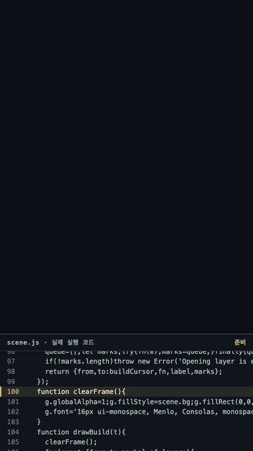

# ASCII Art Animation

**장면 한 줄을 아스키 아트 애니메이션으로.** 위 74%에는 아스키 아트, 아래 26%에는 그 장면을 만드는 실제 JavaScript가 표시됩니다. 빈 화면에서 문자 그림이 완성된 뒤 애니메이션이 시작됩니다. 기본 결과는 버튼 없이 자동재생되는 오프라인 HTML 한 파일입니다.

## 설치

### Node.js 없이 설치

[skills/ascii-art-animation](skills/ascii-art-animation) 폴더를 통째로 복사하세요.

- **Claude Code:** 프로젝트의 `.claude/skills/`에 넣고 `/ascii-art-animation`을 실행하세요.
- **Codex:** 프로젝트의 `.agents/skills/`에 넣고 `$` 메뉴에서 `ascii-art-animation`을 선택하세요.

### Node.js가 이미 있다면: 명령으로 설치

이 스킬이 GitHub에 게시된 뒤, Node.js 22.20 이상이 있는 환경에서 프로젝트 폴더를 열고 사용하는 도구의 명령을 실행하세요.

#### Claude Code

```bash
npx skills add makernari/ascii-art-animation --skill ascii-art-animation -a claude-code
```

#### Codex

```bash
npx skills add makernari/ascii-art-animation --skill ascii-art-animation -a codex
```

## 예시 프롬프트와 미리보기

장면 설명만 입력하면 위에는 아스키 아트, 아래에는 실제 렌더링 코드가 스크롤되는 HTML을 만듭니다. 작업을 시작하기 전에 제작 예상 시간을 알려줍니다.

### 1. 눈 내리는 서울광장의 트리

```text
눈 내리는 서울광장. 커다란 크리스마스트리에 아래에서 위로 불이 켜지고, 꼭대기 별이 반짝인다.
```


### 2. 보름달이 뜬 파리의 에펠탑

```text
보름달이 뜬 파리의 에펠탑
```



영상도 필요하면 프롬프트에 “동영상으로도 만들어줘”라고 덧붙이세요. 환경이 지원하면 MP4를, 아니면 WebM을 시도합니다.
